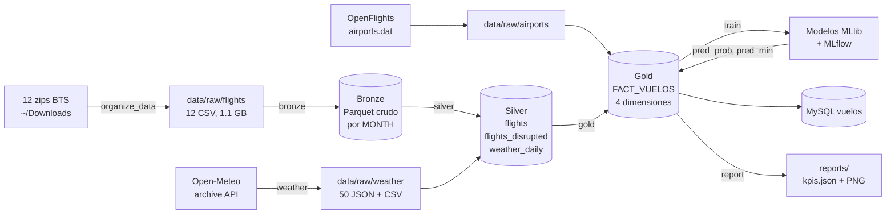
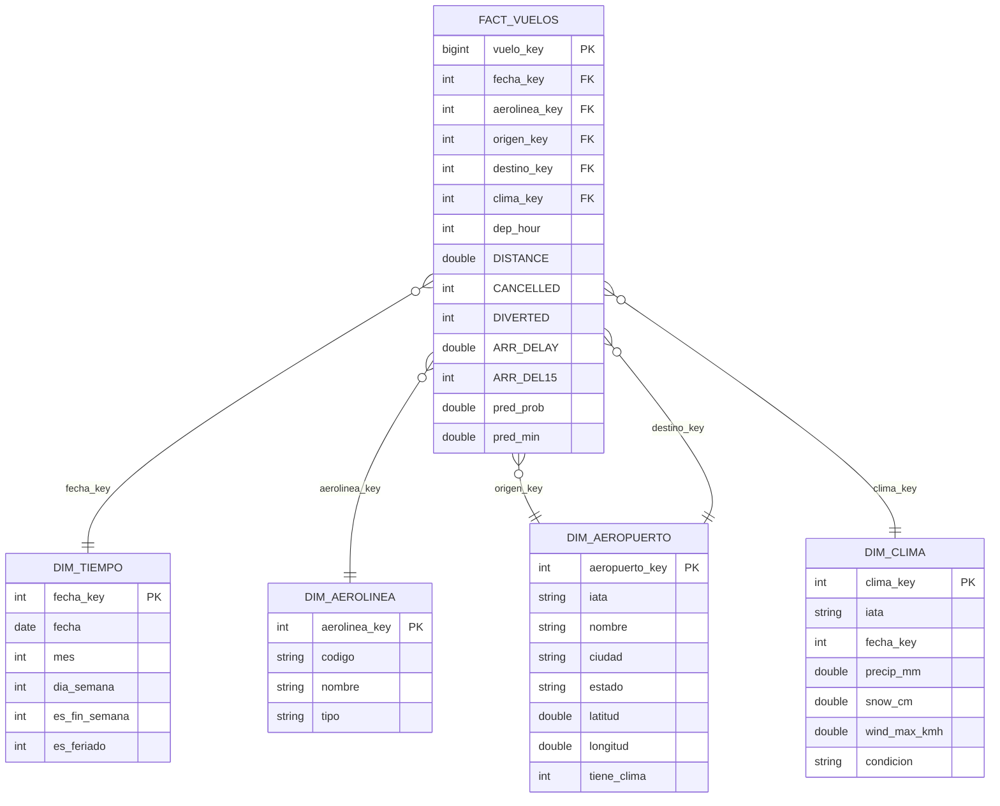

# Prediccion de retrasos de vuelos domesticos (EE. UU. 2025)

Prototipo local de un sistema que predice si un vuelo llegara con retraso (15+ minutos) y
cuantos minutos, pensado para una app de viajes freemium. Usa los datos "On-Time Performance"
del BTS (7,001,619 vuelos de 2025) cruzados con clima historico de Open-Meteo.

El prototipo corre con PySpark en una MacBook Air y replica la arquitectura que tendria en
Microsoft Fabric: capas medallon (Bronze, Silver, Gold) y un esquema estrella para BI.

## Contenido

1. [Requisitos](#requisitos)
2. [Organizar los datos](#organizar-los-datos)
3. [Como correr todo](#como-correr-todo)
4. [Arquitectura medallon](#arquitectura-medallon)
5. [Esquema estrella](#esquema-estrella)
6. [Modelos](#modelos)
7. [Decisiones tecnicas](#decisiones-tecnicas)
8. [KPIs obtenidos](#kpis-obtenidos)
9. [Migracion a Microsoft Fabric](#migracion-a-microsoft-fabric)
10. [Estructura del repositorio](#estructura-del-repositorio)

## Requisitos

| Componente | Version usada | Notas |
|---|---|---|
| macOS + zsh | Apple M4, 16 GB | Probado en MacBook Air |
| Python | 3.12 | `brew install python@3.12` |
| Java | OpenJDK 17 | `brew install openjdk@17` (PySpark lo necesita) |
| MySQL | 8+ (Homebrew) | Opcional: si no conecta, el pipeline sigue |

Java 17 de Homebrew es "keg-only" (no queda en el PATH). No hace falta configurarlo:
`src/spark_session.py` usa `/opt/homebrew/opt/openjdk@17` si `JAVA_HOME` no esta definido.

Entorno virtual e instalacion:

```zsh
make venv          # o: /opt/homebrew/bin/python3.12 -m venv .venv && .venv/bin/pip install -r requirements.txt
source .venv/bin/activate
```

`pandas` queda fijado en `<3` porque PySpark 4.0 no es compatible con pandas 3 (falla la
conversion con Arrow entre Spark y pandas).

### MySQL (opcional)

```zsh
cp .env.example .env    # y pon tus credenciales reales
```

Variables: `DB_HOST`, `DB_PORT`, `DB_NAME=vuelos`, `DB_USER`, `DB_PASSWORD`. La base `vuelos`
debe existir y el usuario necesita permisos sobre ella.

Recomendado para cargar los 7M de vuelos: subir la memoria de InnoDB (como root, una vez):

```zsh
mysql -u root -p -e "SET PERSIST innodb_buffer_pool_size = 2147483648; SET PERSIST innodb_redo_log_capacity = 2147483648;"
```

Con los valores por defecto (128 MB de buffer pool y 100 MB de redo log) la creacion de
indices sobre FACT_VUELOS llego a tardar casi una hora; con 2 GB tarda unos 40 segundos.

## Organizar los datos

1. Descarga del BTS (TranStats, tabla "Reporting Carrier On-Time Performance") un zip por
   cada mes de 2025 con estas 31 columnas:
   `YEAR, MONTH, DAY_OF_MONTH, DAY_OF_WEEK, FL_DATE, OP_UNIQUE_CARRIER, OP_CARRIER_FL_NUM,
   ORIGIN, ORIGIN_CITY_NAME, ORIGIN_STATE_ABR, DEST, DEST_CITY_NAME, DEST_STATE_ABR,
   CRS_DEP_TIME, DEP_DELAY, DEP_DEL15, DEP_TIME_BLK, CRS_ARR_TIME, ARR_DELAY, ARR_DEL15,
   ARR_TIME_BLK, CANCELLED, CANCELLATION_CODE, DIVERTED, DISTANCE, DISTANCE_GROUP,
   CARRIER_DELAY, WEATHER_DELAY, NAS_DELAY, SECURITY_DELAY, LATE_AIRCRAFT_DELAY`.
2. Deja los 12 archivos `T_ONTIME_REPORTING_2026*.zip` en `~/Downloads` (o en otra carpeta y
   usa `--src`).
3. Corre `python -m src.organize_data`.

Todos los zips traen un CSV con el mismo nombre (`T_ONTIME_REPORTING.csv`) y el nombre del
zip no indica el mes (el primero descargado era febrero). Por eso el script no los
descomprime juntos: lee la segunda linea de cada CSV para obtener `MONTH` y extrae en
streaming a `data/raw/flights/vuelos_2025_MM.csv`. Omite meses duplicados (y avisa), nunca
borra los zips y al final verifica que esten los 12 meses con su tamano y conteo de filas.
Si falta un mes, se detiene.

El clima (Open-Meteo) y el catalogo de aeropuertos (OpenFlights) se descargan solos.

## Como correr todo

Un solo comando:

```zsh
python -m src.run_pipeline          # o: make all
```

Cada etapa por separado:

| Etapa | Comando | Make | Que hace |
|---|---|---|---|
| 0 | `python -m src.organize_data` | `make organize` | zips a `data/raw/flights` |
| 1 | `python -m src.bronze` | `make bronze` | CSV a Parquet crudo + airports.dat |
| 2 | `python -m src.weather` | `make weather` | clima Open-Meteo (con cache) |
| 3 | `python -m src.silver` | `make silver` | limpieza, separacion y enriquecimiento |
| 4 | `python -m src.gold` | `make gold` | esquema estrella + carga a MySQL |
| 4b | `python -m src.mysql_loader` | `make mysql` | solo la carga a MySQL |
| 5 | `python -m src.train` | `make train` | modelos, MLflow, predicciones en Gold |
| 6 | `python -m src.report` | `make report` | KPIs y graficas en `reports/` |
| 7 | `python -m src.predict` | `make predict` | ejemplos de `predict()` |
| 8 | `python -m src.evaluate` | `make evaluate` | modelo vs baselines, tiempos, consultas, volumen, importancia |
| 9 | `python -m src.export_powerbi` | `make export` | CSV agregados para Power BI en `deliverables/powerbi` |
| 10 | `python -m src.figures` | `make figures` | figuras finales en `deliverables/figuras` |
| 11 | `python -m src.summary` | `make summary` | `deliverables/RESUMEN_TECNICO.md` generado desde las metricas |
| | | `make deliverables` | etapas 8 a 11 + `deliverables_fase3.zip` |

Opciones utiles:

```zsh
python -m src.run_pipeline --from silver       # reanudar desde una etapa
python -m src.run_pipeline --only report       # solo algunas etapas
python -m src.run_pipeline --skip-mysql        # sin MySQL
python -m src.weather --top 100                # mas aeropuertos con clima
python -m src.train --gbt-sample 0.5           # GBT con mas datos
make mlflow-ui                                 # ver los runs en http://127.0.0.1:5000
```

`python -m src.run_pipeline` corre las 12 etapas (0 a 11): el pipeline de datos y modelos y
el paquete de entrega de la Fase 3 en `deliverables/` (indicadores en `kpis.json`, CSV para
Power BI, figuras y resumen tecnico). Para comprimirlo: `make deliverables`.

En la corrida completa, Gold no carga MySQL: la carga se hace una sola vez al final del
entrenamiento, ya con las predicciones, para no subir 7M de filas dos veces.

Usar `predict()` desde Python:

```python
from src.predict import predict
predict("AA", "ORD", "LGA", "2025-12-22", "17:45")
# {'prob_retraso': 0.496, 'minutos_estimados': 11.1, 'distancia_millas': 733.0, 'clima_usado': {...}, ...}
```

Acepta la aerolinea por codigo (`AA`) o nombre (`American Airlines`) y la hora como `17` o
`"17:45"`. Si la ruta no tiene historial, usa la distancia en linea recta entre aeropuertos.

## Demo de la app freemium

```zsh
make app        # o: .venv/bin/streamlit run app/demo_app.py  ->  http://localhost:8501
```

Requiere haber corrido el pipeline (usa los modelos de `data/models` y los catalogos de Gold y
Silver). La primera consulta tarda unos 10 s mientras carga Spark y los modelos; despues cada
consulta tarda menos de un segundo.

| Plan | Que muestra |
|---|---|
| Gratis | Probabilidad de llegar 15+ min tarde, nivel de riesgo (bajo, moderado, alto) y tasa historica de la ruta |
| Premium (simulado con un interruptor, sin pagos) | Ademas: minutos estimados, clima del origen ese dia, mejor hora para volar (solo horas con salidas reales en la ruta) y comparacion de las aerolineas de la ruta |

Todas las predicciones de una consulta (el vuelo, cada hora del dia y cada aerolinea) se
calculan en un solo trabajo de Spark con `predict_many()`. La demo usa fechas de 2025 porque es
el ano con clima historico descargado.

## Arquitectura medallon



| Capa | Ruta | Contenido | Reglas |
|---|---|---|---|
| Raw | `data/raw/` | CSV mensuales, JSON de clima, airports.dat | Tal cual se descargan |
| Bronze | `data/bronze/flights` | 7,001,619 filas, 130 MB | Todo como texto, sin transformar, particionado por MONTH, columnas de linaje `_source_file` y `_ingested_at` |
| Silver | `data/silver/` | `flights` (6,879,484 completados con clima), `flights_disrupted` (122,134 cancelados y desviados), `weather_daily` (18,250 aeropuerto-dia) | Tipos correctos, nulos con politica explicita, sin duplicados, variables derivadas |
| Gold | `data/gold/` | Esquema estrella (abajo), con predicciones | Listo para BI y para la app |

## Esquema estrella



| Tabla | Filas | Grano |
|---|---|---|
| FACT_VUELOS | 7,001,618 | Un vuelo programado (completados, cancelados y desviados) |
| DIM_TIEMPO | 365 | Un dia de 2025, con los 11 feriados federales |
| DIM_AEROLINEA | 14 | Una aerolinea (codigo BTS, nombre, tipo: principal, bajo costo, regional) |
| DIM_AEROPUERTO | 352 | Un aeropuerto; una sola dimension usada como origen y destino |
| DIM_CLIMA | 18,251 | Un aeropuerto-dia (50 aeropuertos x 365 dias) + miembro `-1 sin_datos` |

El hecho tambien guarda las medidas originales del BTS (`DEP_DELAY`, causas de retraso,
etc.) para analisis en BI. Esas columnas nunca se usan como entrada del modelo.

## Modelos

Spark MLlib, registrados en MLflow local (`mlflow.db`, experimento `retrasos_vuelos_2025`).

| Modelo | Objetivo | Detalle |
|---|---|---|
| Regresion logistica | `ARR_DEL15` (retraso 15+ min) | Pesos de clase balanceados (2.27 retrasado, 0.64 a tiempo); one-hot de aerolinea, origen, destino, dia y hora |
| Regresion lineal | Minutos de `ARR_DELAY` | Baseline |
| GBT (Spark) | Minutos de `ARR_DELAY` | 60 arboles, profundidad 6, sobre el 30% del entrenamiento; categoricas nativas (maxBins 400) |

Variables de entrada (18): aerolinea, origen, destino, dia de semana, hora programada, mes
(seno y coseno), fin de semana, distancia, y clima de origen (precipitacion, nieve, viento
maximo, temperatura maxima y minima, banderas de lluvia, nieve y viento fuerte, y
`has_weather`).

Split temporal: entrenamiento enero a octubre (5,752,264 vuelos), prueba noviembre y
diciembre (1,127,220 vuelos).

## Decisiones tecnicas

**Fuga de datos (la mas importante).** La app predice antes de que el vuelo salga, asi que
el modelo solo usa variables conocidas de antemano. Quedan prohibidas como entrada
`DEP_DELAY`, `DEP_DEL15`, `ARR_DELAY` y las cinco columnas de causa (`CARRIER_DELAY`,
`WEATHER_DELAY`, `NAS_DELAY`, `SECURITY_DELAY`, `LATE_AIRCRAFT_DELAY`): solo existen despues
del vuelo y con ellas el modelo se veria casi perfecto en pruebas pero seria inutil en la
app. `src/train.py` valida esta regla antes de entrenar y falla si alguna se cuela. El clima
usado es el observado ese dia; en produccion seria el pronostico, que es la version
"conocida de antemano" de la misma variable.

**Split temporal y no aleatorio.** Un split aleatorio mezcla vuelos del mismo dia (misma
tormenta, mismo atasco) entre entrenamiento y prueba y sobreestima el desempeno. Entrenar con
el pasado y probar con el futuro simula el uso real.

**Mes como seno y coseno.** Noviembre y diciembre no existen en entrenamiento; como categoria
el modelo no sabria que hacer con ellos. La codificacion ciclica da continuidad entre meses.

**Probabilidad corregida.** Los pesos de clase inflan la probabilidad (la media sube a 0.41
con una tasa real de 0.22). Las metricas de clasificacion usan el modelo ponderado con umbral
0.5; `pred_prob` se guarda con correccion de prior (multiplicar los odds por
peso_negativo / peso_positivo), que es lo que tiene sentido mostrar al usuario. En los meses de
entrenamiento queda a unos 3 puntos de la tasa real.

**Recorte de minutos.** `ARR_DELAY` se recorta a los percentiles 1 y 99 de entrenamiento
(-37 y 222 min). Los retrasos de 10+ horas son eventos raros que dominan el RMSE sin ayudar a
predecir el caso tipico. Los percentiles salen solo de entrenamiento para no usar
informacion del futuro. Tambien se reporta el RMSE contra los minutos sin recortar.

**Bronze todo como texto.** Conserva el dato tal cual (`0659`, `2/1/2025 12:00:00 AM`); si el
BTS cambia un formato no se pierde nada. Se lee con schema explicito (sin `inferSchema`, que
recorre los datos dos veces y puede adivinar mal) y `FAILFAST`.

**Politica de nulos en Silver.** Filas sin clave minima se descartan (0 en 2025); completados
sin `ARR_DELAY` se descartan (1); las causas de retraso nulas en completados se ponen en 0
(el BTS solo las llena con retraso de 15+ min); el clima nulo se marca con `has_weather = 0`.
Duplicados por clave de negocio (fecha, aerolinea, numero de vuelo, origen, destino, hora): 0.

**Clima por dia local.** Open-Meteo se llama con `timezone=auto`, asi el dia del clima es el
dia local del aeropuerto, igual que `FL_DATE`. Una llamada por aeropuerto para todo el ano,
cacheada en disco, con pausa de 1.5 s y reintentos con espera exponencial.

**Umbrales de clima** (basados en la distribucion real): lluvia `>= 1 mm`, nieve `> 0 cm`,
viento fuerte `>= 30 km/h` (sobre el percentil 95).

**Llaves del esquema estrella.** `vuelo_key` es `xxhash64` de la clave de negocio: estable entre
corridas (las predicciones se vuelven a unir al hecho sin depender del orden) y sin colisiones
en los 7M de vuelos. Los vuelos sin clima apuntan a `clima_key = -1` en vez de NULL.

**Spark en una MacBook Air.** `local[*]`, 6 GB de driver (deja ~10 GB para macOS y pandas),
32 particiones de shuffle (el default de 200 crea tareas diminutas para este volumen) y AQE
para ajustarlas en ejecucion. Broadcast de las tablas chicas (clima, dimensiones) en los joins.

**Carga a MySQL.** El servidor tiene `local_infile` apagado, asi que se usa INSERT multi-fila
por lotes de 20 mil. FACT_VUELOS se crea sin indices y la llave primaria, los indices y las
llaves foraneas se agregan al final con `ALGORITHM=INPLACE` y `foreign_key_checks=0` (con
checks activos MySQL copia la tabla fila por fila: mas de 70 minutos). La integridad
referencial se verifica aparte (0 huerfanos). El modo `auto` mide la velocidad y, si la carga
completa pasara de 20 minutos, cambia a una muestra determinista por hash; con la memoria de
MySQL ajustada carga el 100% en unos 2.5 minutos.

## KPIs obtenidos

Tomados de `reports/kpis.json` (corrida completa con `python -m src.run_pipeline`).

| KPI | Valor |
|---|---|
| Registros procesados (Bronze) | 7,001,619 |
| Vuelos completados para modelar (Silver) | 6,879,484 |
| Cancelados y desviados | 122,134 |
| Filas en FACT_VUELOS (Gold y MySQL) | 7,001,618 |
| Cobertura de clima (vuelos completados) | 78.44% (top 50 aeropuertos) |
| Tasa de retraso global (ARR_DEL15) | 22.31% |
| ROC AUC (prueba nov-dic) | 0.659 |
| Precision / Recall / F1 | 0.371 / 0.444 / 0.404 |
| MAE / RMSE minutos (GBT) | 24.81 / 42.68 |
| MAE / RMSE minutos (baseline lineal) | 25.10 / 43.07 |

Matriz de confusion (prueba, umbral 0.5):

| | Predicho a tiempo | Predicho retraso |
|---|---|---|
| Real a tiempo | 658,944 | 200,993 |
| Real retraso | 148,704 | 118,579 |

Tiempos por etapa en la corrida completa desde cero (`python -m src.run_pipeline`, capas
derivadas borradas antes; total 7.4 minutos incluyendo el arranque de cada etapa):

| Etapa | Segundos |
|---|---|
| Organizar | 8 |
| Bronze | 20 |
| Clima (con cache; la primera descarga tarda ~4 min) | 5 |
| Silver | 56 |
| Gold | 13 |
| Modelos (3 modelos + scoring de 7M) | 141 |
| MySQL (7M filas + indices, dentro de la etapa de modelos) | 156 |
| Reporte | 6 |

Dos corridas completas dieron exactamente las mismas metricas (semillas fijas y split
determinista).

Graficas en `reports/`:

| Grafica | Hallazgo |
|---|---|
| `retraso_por_mes.png` | Pico en junio y julio (28.9%) y en diciembre (26.8%); minimo en septiembre (16.6%) |
| `retraso_por_hora.png` | El riesgo crece durante el dia: 8.9% a las 5 am, 32.6% a las 7 pm |
| `retraso_por_aerolinea.png` | De 17.3% (Hawaiian) a 27.9% (Frontier) |
| `top10_rutas_retrasadas.png` | Rutas con 1,000+ vuelos; encabeza DCA a HPN (39.5%) |
| `efecto_clima.png` | Despejado 19.4%; lluvia 29.4% (+51%); nieve 36.2% (+86%); viento 25.3% (+30%) |

**Como leer estos resultados.** Un AUC de 0.66 es lo esperable con solo informacion previa al
vuelo: la mayor fuente de retraso (el avion que llega tarde del vuelo anterior) no se conoce de
antemano. El modelo sirve para ordenar vuelos por riesgo (en prueba, la tasa real sube del 12%
en el decil de menor probabilidad al 81% en el de 0.7), no para una prediccion exacta de cada
vuelo.

**Limitacion conocida: diciembre.** Con un solo ano de datos el modelo nunca vio una temporada
navidena: en diciembre predice 17.8% de probabilidad media contra 26.8% real. Mejoras
propuestas: variables de feriados ("dias al proximo feriado", tambien conocidas de antemano) y
entrenar con 2024 completo.

## Migracion a Microsoft Fabric

El prototipo ya separa las capas y usa Spark y Parquet, asi que la migracion es directa:

| Prototipo local | Microsoft Fabric |
|---|---|
| `data/raw/` | Lakehouse `lh_raw`, carpeta `Files/` en OneLake |
| `data/bronze`, `data/silver`, `data/gold` (Parquet) | Lakehouses `lh_bronze`, `lh_silver`, `lh_gold` con tablas Delta en OneLake |
| `src/*.py` | Notebooks de Spark (un notebook por etapa) |
| `src/run_pipeline.py` | Data Factory pipeline que encadena los notebooks |
| `src/spark_session.py` | La sesion la da Fabric; se quitan `master` y `driver.memory` |
| Open-Meteo con `requests` | Notebook o Copy activity programada que escribe en `Files/weather` |
| MLflow local (`mlflow.db`) | Experimentos y modelos de ML de Fabric (MLflow integrado) |
| MySQL `vuelos` | Warehouse de Fabric o el SQL analytics endpoint del lakehouse Gold |
| `reports/*.png` | Reporte de Power BI en modo Direct Lake sobre `lh_gold` |
| `predict()` | Modelo registrado + scoring por lotes (PREDICT) o endpoint para la app |

Pasos:

1. **OneLake.** Crear el workspace y los lakehouses. Subir los CSV a `lh_raw/Files/flights`
   (o automatizar la descarga del BTS con Data Factory).
2. **Formato Delta.** Cambiar `.parquet(path)` por `.format("delta").saveAsTable("nombre")`.
   Delta agrega transacciones ACID, time travel y `MERGE` para cargas incrementales (en vez
   de `overwrite` completo, `MERGE` por `vuelo_key` para los meses nuevos).
3. **Notebooks.** Cada modulo de `src/` se vuelve un notebook; la logica no cambia. Las rutas
   pasan a `abfss://...onelake.dfs.fabric.microsoft.com/...` o a tablas del lakehouse
   asociado. Secretos (si los hubiera) en Azure Key Vault en vez de `.env`.
4. **Orquestacion.** Un Data Factory pipeline con una actividad Notebook por etapa,
   programado mensualmente cuando el BTS publica un mes nuevo.
5. **Modelos.** `mlflow` funciona igual dentro de Fabric: los runs aparecen como Experiment y
   el modelo se registra como ML Model. Las predicciones se escriben en `FACT_VUELOS` con un
   notebook de scoring por lotes.
6. **Power BI con Direct Lake.** Crear un modelo semantico sobre las tablas Delta de
   `lh_gold` (FACT_VUELOS y las 4 dimensiones, con las relaciones del esquema estrella; la
   relacion con DIM_AEROPUERTO se crea dos veces, origen activa y destino inactiva con
   `USERELATIONSHIP`). Direct Lake lee los archivos Delta de OneLake sin importar ni copiar
   datos, con rendimiento similar a Import. Optimizar con `OPTIMIZE` y V-Order para que
   Direct Lake no caiga a DirectQuery.
7. **App.** Para predicciones en tiempo real, exponer el modelo como endpoint (o exportarlo a
   un servicio ligero), porque levantar Spark por cada consulta tarda segundos.

## Estructura del repositorio

```
.
├── Makefile               atajos (make all, make silver, ...)
├── requirements.txt
├── .env.example           plantilla de credenciales MySQL
├── src/
│   ├── config.py          rutas y parametros
│   ├── spark_session.py   SparkSession ajustada a la Mac
│   ├── utils.py           descargas con reintentos, cronometro, metricas por etapa
│   ├── organize_data.py   Paso 0: zips a CSV mensuales
│   ├── bronze.py          Paso 2: ingesta cruda
│   ├── weather.py         Paso 3: clima Open-Meteo
│   ├── silver.py          Paso 4: limpieza y enriquecimiento
│   ├── gold.py            Paso 5: esquema estrella
│   ├── mysql_loader.py    Paso 5: carga a MySQL
│   ├── features.py        variables del modelo (regla de fuga de datos)
│   ├── train.py           Paso 6: modelos, MLflow, predicciones
│   ├── report.py          Paso 7: KPIs y graficas
│   ├── predict.py         Paso 7: predict() y predict_many()
│   └── run_pipeline.py    orquestador
├── app/demo_app.py        demo Streamlit de la app freemium (make app)
├── notebooks/             (opcional)
├── reports/               kpis.json, stage_metrics.json, graficas PNG
└── data/                  (ignorado en git) raw, bronze, silver, gold, models
```
